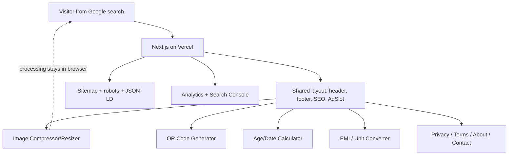

# Architecture

## Goals that shape the design

1. **Cheap to run at scale.** Hosting must stay on free tiers even with high traffic. This is
   why tools process data **client-side** (in the browser) wherever possible — no uploads, no
   server CPU per request, no storage bills.
2. **SEO-first.** Each tool is a standalone route with its own metadata and original
   explainer/FAQ content, so it can rank for long-tail queries. This is the traffic engine and
   also satisfies AdSense's original-content requirement.
3. **Easy to extend.** Adding a tool should mean: write a pure logic module + a UI component,
   register it in one place, and reuse the shared shell. No rearchitecting.
4. **Ads are switch-ready.** A single env-flag-controlled `AdSlot` component lets AdSense be
   turned on after approval without touching individual pages.

## High-level diagram

## Layers

### 1. Shell (shared layout)
`components/layout` provides `Header` (logo + tool nav), `Footer` (legal links), and
`Container`/`SiteShell` wrappers. The root `app/layout.tsx` wires fonts and the shell so every
page is consistent. Ad slots live in the shell so placement is controlled in one place.

### 2. Tool registry
`lib/tools.ts` is the single source of truth: a list of tool descriptors (slug, title, short
description, category, icon, keywords). The homepage grid, the header nav, and the sitemap all
read from this registry, so adding a tool to the registry surfaces it everywhere.

### 3. Tool pages
Each tool lives at `app/tools/<slug>/page.tsx`. A page:
- exports `metadata` (title, description, canonical, Open Graph) via the SEO helper,
- renders the `ToolPage` shell (title, description, the interactive tool, an explainer/FAQ
  content block, and reserved ad slots),
- mounts a **client component** that performs the actual work in the browser.

The split matters: the page itself stays server-rendered (good for SEO), and only the
interactive widget is a client component (`"use client"`).

### 4. Tool logic (pure functions)
The real logic (image resize math, EMI amortization, date math, unit conversion) lives in
pure, framework-free modules under `lib/`. These are directly unit-tested without rendering
any UI, which keeps tests fast and the logic reusable.

### 5. SEO infrastructure
- `app/sitemap.ts` and `app/robots.ts` use Next.js conventions and read from the tool
  registry so new tools are included automatically.
- JSON-LD (`WebApplication` + `FAQPage`) is injected per tool page via an SEO helper.
- Metadata is generated per route with the Next.js Metadata API.

### 6. Ads + analytics
- `components/ads/AdSlot.tsx` renders nothing (or a dev placeholder) when
  `NEXT_PUBLIC_ADS_ENABLED !== "true"`, and renders the AdSense `<ins>` markup when enabled.
- Analytics loads only in production and only when a measurement ID is configured.

## Request flow (example: Image Compressor)

1. Google sends a user to `/tools/image-compressor`.
2. Next.js serves the server-rendered page: title, explainer content, FAQ, ad slots — all
   crawlable HTML.
3. The interactive compressor (a client component) hydrates in the browser.
4. The user picks an image; it is read, resized, and re-encoded entirely via the Canvas API in
   the browser. Nothing is uploaded.
5. The user downloads the result. The server never saw the file.

## "Private by design" — the differentiator

Client-side processing is also the product's main differentiator, so it is surfaced as a
first-class feature rather than an implementation detail:

- Every tool page shows a **PrivacyBadge** stating that processing happens in the browser and
  files/inputs are never uploaded or stored by us.
- The claim is **accurate by construction** — there is no backend endpoint receiving user
  content, no database, no storage. A user can verify it in the browser DevTools Network tab
  (no upload requests for the actual processing).

### Honest boundaries of the privacy claim (do not overclaim)
- **Ads and analytics do collect usage data** (AdSense/Analytics set cookies and collect IP,
  device and behaviour data). This must be disclosed in the Privacy Policy — the badge links to
  it. We say "we don't collect or store the content you process", not "we collect nothing".
- **The host/CDN (Vercel) logs standard request metadata** (IP, request path). Normal for any
  website; it means "zero data" is not literally true.
- "Secure" here means **data minimisation + client-side processing + HTTPS**, not server-side
  encryption of user files (there are none on the server to encrypt).

Planned stronger enforcement (future tasks): a strict Content Security Policy and an
offline-capable mode for the sensitive tools, plus an optional "verify it yourself" explainer.

## Why this stays on free tiers
Because steps 3–5 run on the user's device, server work per visit is just serving static-ish
HTML/JS. That scales to large traffic on Vercel's free tier, and there is no storage or
bandwidth cost for user files.
